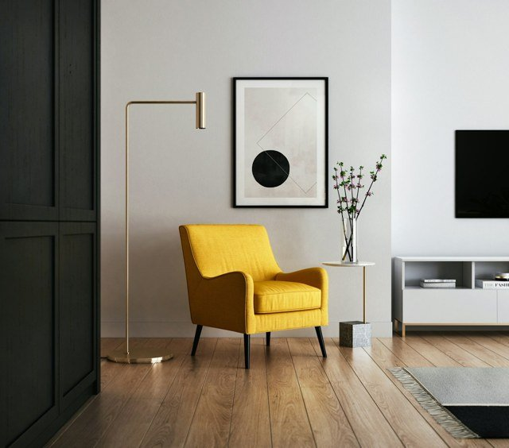
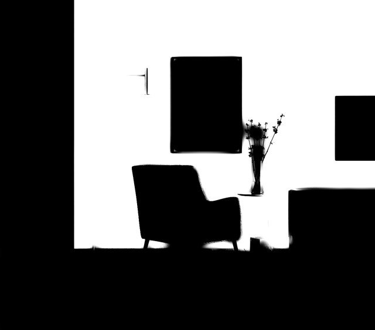
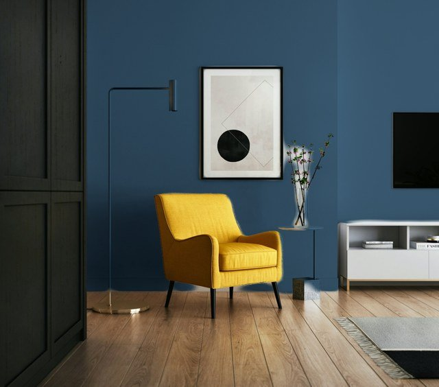

# 牆面換色 WallPainter

拍一張室內照片，App 會自動找出牆面，在**保留家具、擺設與原本光影**的情況下換上新的牆色。
全部在 iPhone 上離線運算，照片不會上傳。

| 原圖 | 自動偵測的牆面 | 換成海軍藍 |
|---|---|---|
|  |  |  |

## 功能

- **拍照或從相簿選圖**，約 1–3 秒自動辨識牆面
- **30 種常用室內色**（白、灰、綠、藍、大地色、深色）＋自訂任意顏色＋收藏「我的顏色」
- **保留光影**：陰影、光線漸層、牆面紋理都會留著，看起來像真的漆上去
- **修正工具**：
  - 補畫：手指塗抹漏掉的牆面
  - 擦除：把不該上色的地方（櫃子、天花板）擦掉
  - 魔術棒：點一下漏掉的牆，自動選取同色的整片區域（不會跨到地板或天花板）
  - 復原、還原成自動偵測的結果
- **按住看原圖**，馬上比較換色前後
- **儲存到相簿、分享**

## 安裝到 iPhone

App 是自用的，不需要上架。有兩種方式：

### 方式 A：用 Mac + Xcode（推薦）

需要：Mac、Xcode 16 以上、免費的 Apple ID 即可。

```bash
brew install xcodegen      # 只要裝一次
git clone <這個 repo>
cd wall-color-simulator
xcodegen                    # 產生 WallPainter.xcodeproj
open WallPainter.xcodeproj
```

1. Xcode 左側點 **WallPainter** 專案 → **Signing & Capabilities** → **Team** 選你的 Apple ID
   （沒有的話按 *Add an Account…* 登入）。如果出現 bundle ID 已被使用，把 `tw.dj13.wallpainter` 改成別的名字。
2. 用線把 iPhone 接上 Mac，上方裝置選你的 iPhone，按 ▶︎ 執行。
3. 第一次需要在 iPhone 上：
   - **設定 > 隱私權與安全性 > 開發者模式** 打開（會要求重新開機）
   - **設定 > 一般 > VPN 與裝置管理** 信任你的開發者帳號

> 用免費 Apple ID 安裝的 App **7 天後會過期**，到時候再接上 Mac 按一次 ▶︎ 就好。
> 付費開發者帳號（每年 US$99）則是一年。

### 方式 B：沒有 Mac

每次推送程式碼，GitHub Actions 都會自動編譯出 `WallPainter-unsigned.ipa`：

1. 到 GitHub repo 的 **Actions** 分頁 → 點最新一次成功的 **Build iOS app** → 下載 **WallPainter-unsigned-ipa**
2. 在 Windows 或 Mac 安裝 [Sideloadly](https://sideloadly.io/)
3. iPhone 接上電腦，把 `.ipa` 拖進 Sideloadly，登入 Apple ID 後按 Start
4. iPhone 上同樣要打開「開發者模式」並信任開發者帳號（見上方）

同樣 7 天要重新安裝一次（Sideloadly 可以設定自動續簽）。

## 使用小技巧

- 退後一點讓整面牆入鏡，光線均勻、避免強烈逆光，效果最好
- 白牆換成深色也可以，亮度會依照原本的光影自動調整
- 魔術棒選太少就把「範圍」調大，選太多就按復原再調小
- 編輯牆面範圍時，上色區域會疊一層淡紫色，方便看清楚涵蓋到哪裡；切回「配色」就會消失

## 運作原理

```
照片 ─→ SegFormer-B5（Core ML，Neural Engine）─→ 160×160 牆面機率
                                                   │
             原圖灰階當引導 ─→ Guided Filter ←──────┘  邊緣貼齊家具與牆角
                                   │
                              牆面遮罩（2048px）
                                   │
   新顏色 × (每個像素亮度 ÷ 牆面平均亮度) ─→ 線性 RGB 合成 ─→ 結果
```

- **牆面辨識**：NVIDIA SegFormer-B5，在 ADE20K 室內外場景資料集訓練（150 類，其中一類是「牆」）。
  轉成 Core ML 並做 8-bit 權重量化（83 MB），與原始模型的遮罩一致度 > 99.5%。
- **邊緣處理**：Guided Filter 讓遮罩邊緣貼齊照片裡真正的邊界。
- **換色**：在線性色彩空間把牆面換成目標色，乘上每個像素相對於牆面平均的亮度，
  所以平均亮度的地方剛好是你選的顏色，陰影處較暗、受光處較亮，紋理也保留。

## 專案結構

```
WallPainter/                 iOS App（SwiftUI）
  App/                       進入點
  Views/                     首頁、編輯畫面、畫布、色盤
  Model/                     編輯狀態、色票
  Platform/                  Core ML 推論、相機、相簿、影像轉換
Packages/WallPainterCore/    影像處理核心（純 Swift，可在 Linux/macOS 跑單元測試）
  Sources/WallPainterCore/   遮罩精修、換色、筆刷、魔術棒
  Sources/wallpaint-cli/     在電腦上跑同一套處理的除錯工具
Models/WallSegmenter.mlpackage   牆面辨識模型
tools/                       模型轉換、驗證與參數調整腳本
project.yml                  XcodeGen 設定（產生 .xcodeproj）
```

### 開發

```bash
swift test --package-path Packages/WallPainterCore      # 核心單元測試（macOS 或 Linux）

# 重新轉換模型（需要 Python：torch、transformers、coremltools）
cd tools && python convert_model.py
python verify_model.py                                  # macOS：用 Core ML 實際跑一次

# 在電腦上用真正的 Swift 處理流程跑照片
swift build -c release --package-path ../Packages/WallPainterCore
python swift_pipeline_check.py samples/s2.jpg "#2F4A5E" out/s2.jpg
```

## 授權注意

牆面辨識模型來自 NVIDIA SegFormer，授權為
[NVIDIA Source Code License](https://github.com/NVlabs/SegFormer/blob/master/LICENSE)，**僅限非商業用途**。
自用沒有問題；如果之後要商業上架，需要換成可商用的模型（例如用 ADE20K 自行訓練的 Mask2Former / DeepLabV3+）。

範例照片來自 Unsplash 與 Pexels（免費授權）。
